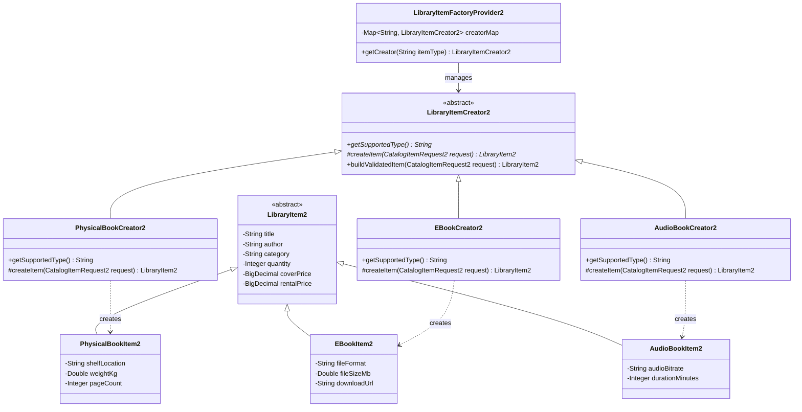
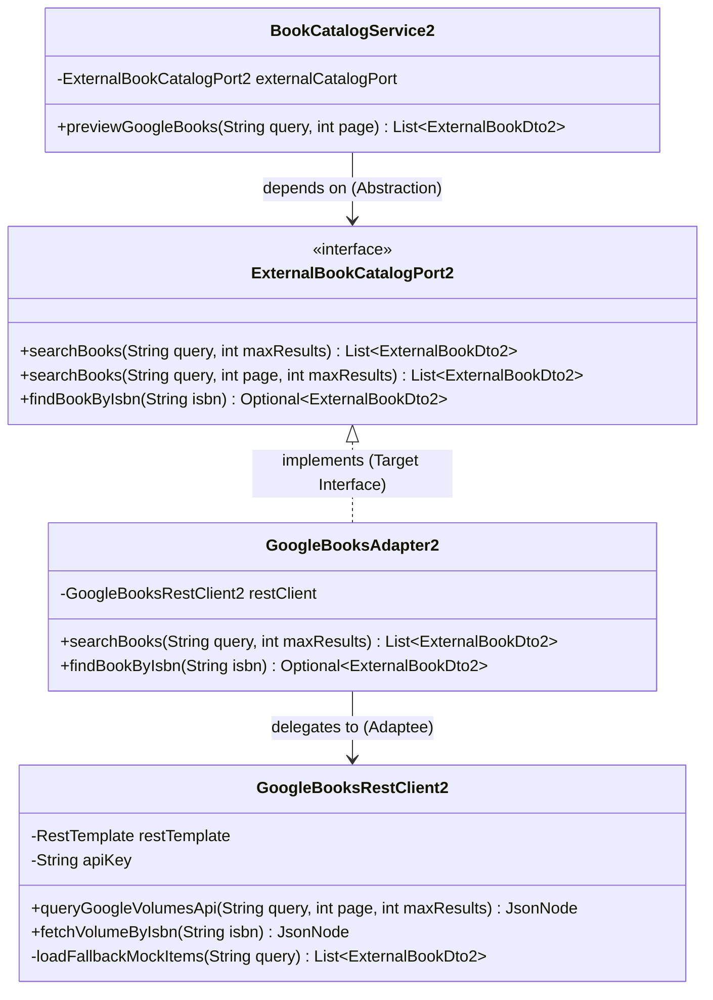
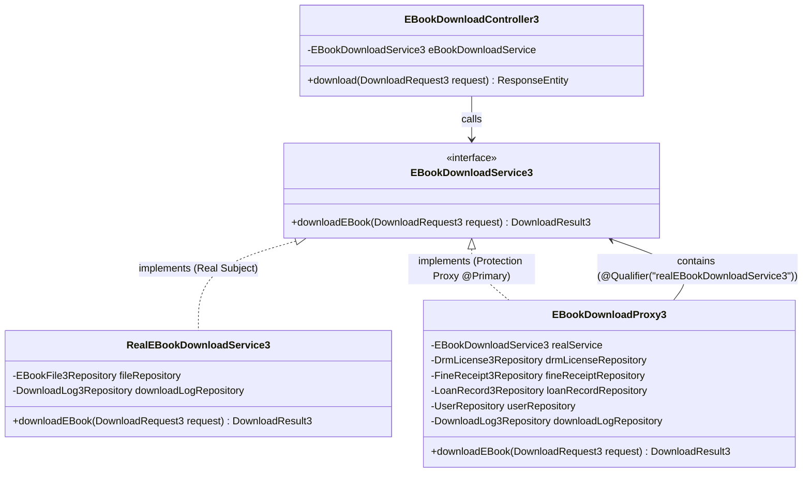
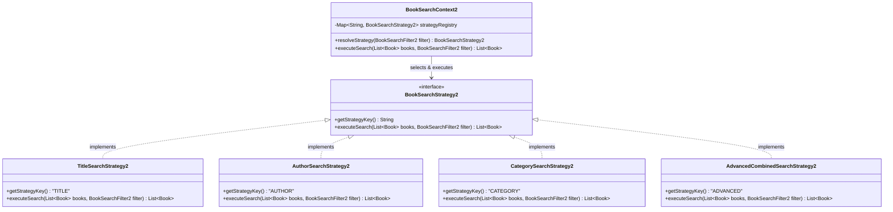

# TÀI LIỆU ĐẶC TẢ DỰ ÁN & HƯỚNG DẪN VIẾT TIỂU LUẬN DÀNH CHO CLAUDE (BẢN CHUẨN XÁC THỰC 100% VỚI CODE)
> **Học phần:** Mẫu thiết kế cho phần mềm _ HK1 2026-2027 (Lớp: `020100138402`)  
> **Đề tài lựa chọn:** Dự án 5 - Hệ thống Quản lý Thư viện số (Digital Library Management System)  
> **Tài liệu này dùng để:** Cung cấp thông tin kỹ thuật chính xác tuyệt đối từ mã nguồn dự án để Claude AI viết bài báo cáo tiểu luận hoàn chỉnh (khoảng 60–70 trang) đạt điểm tối đa (10/10).

---

## 1. YÊU CẦU ĐỀ TÀI & BAREM ĐIỂM CỦA GIẢNG VIÊN

### 1.1. Yêu cầu kỹ thuật cốt lõi:
1. **Bao phủ đủ 3 nhóm Mẫu thiết kế (Design Patterns) GoF:**
   - **Nhóm Creational Patterns (Tạo dựng):** Tối thiểu 02 mẫu (Đã chọn: **Factory Method** + **Builder**).
   - **Nhóm Structural Patterns (Cấu trúc):** Tối thiểu 02 mẫu (Đã chọn: **Adapter** + **Proxy**).
   - **Nhóm Behavioral Patterns (Hành vi):** Tối thiểu 02 mẫu (Đã chọn: **Strategy** + **Template Method**).
2. **Chứng minh và tuân thủ 5 nguyên lý SOLID:**
   - **S (SRP):** Single Responsibility Principle (Đơn trách nhiệm).
   - **O (OCP):** Open/Closed Principle (Mở/Đóng).
   - **L (LSP):** Liskov Substitution Principle (Thay thế Liskov).
   - **I (ISP):** Interface Segregation Principle (Phân tách giao diện).
   - **D (DIP):** Dependency Inversion Principle (Đảo ngược phụ thuộc).
3. **Sản phẩm bàn giao:** File báo cáo tiểu luận (Word/PDF), Link GitHub repository truy cập được, và Ứng dụng demo kèm kịch bản kiểm thử (Test Cases).

### 1.2. Thang điểm đánh giá (Tổng 10 điểm):
- **1. Bố cục (1.5 điểm):** Trang bìa, mục lục tự động, danh mục từ viết tắt/hình ảnh/bảng biểu, bố cục logic, bảng phân công nhiệm vụ và tỷ lệ đóng góp của các thành viên (0.5đ).
- **2. Hình thức (1.5 điểm):** Trình bày font, size, canh lề, chú thích sơ đồ/bảng biểu, trích dẫn tài liệu tham khảo chuẩn APA/IEEE.
- **3. Nội dung chính (7.0 điểm):**
  - *Tổng quan về đề tài và bài toán thực tế (0.5 điểm):* Bối cảnh, mục tiêu, phạm vi, tác nhân, yêu cầu chức năng/phi chức năng, sơ đồ Use Case và đặc tả Use Case cốt lõi.
  - *Cơ sở lý thuyết và Kiến trúc hệ thống (1.5 điểm):* Lý thuyết Design Patterns & SOLID, kiến trúc tổng thể 3 tầng (3-Tier/MVC/Clean Architecture), sơ đồ thực thể liên kết ERD.
  - *Phân tích và Thiết kế chi tiết các Mẫu thiết kế áp dụng (2.5 điểm):* Class Diagram & Sequence Diagram cho từng pattern, phân tích so sánh ưu/nhược điểm so với thiết kế thường, đánh giá SOLID.
  - *Cài đặt, Thử nghiệm và Đánh giá kết quả (1.5 điểm):* Cấu trúc mã nguồn sạch, minh chứng code của các pattern, kết quả kiểm thử tự động (Test Cases), kịch bản demo, đánh giá hiệu năng & bảo trì.
  - *Vấn đáp và hiểu biết (1.0 điểm):* Bảo vệ trực tiếp ngày báo cáo.

---

## 2. TỔNG QUAN KIẾN TRÚC & CÔNG NGHỆ THỰC TẾ TRONG DỰ ÁN

- **Ngôn ngữ:** Java 17 / Java 21 LTS
- **Framework cốt lõi:** Spring Boot 3.3.2 (Spring MVC, Spring Data JPA, Spring Security)
- **Bảo mật & Xác thực:** JWT (JSON Web Token) Stateless Authentication + Phân quyền RBAC (`ADMIN`, `USER`)
- **Cơ sở dữ liệu:**
  - Production/Dev: PostgreSQL trên đám mây (Supabase)
  - Unit Test: H2 In-Memory Database (`application-test.properties`)
- **Lưu trữ tệp tin:** Supabase Storage Bucket tích hợp lưu trữ tệp E-Book PDF cục bộ (Local fallback tại `uploads/ebooks/`)
- **Frontend:** Single Page Application (SPA), Vanilla HTML5/CSS3/Modern JavaScript (Giao diện Glassmorphism hiện đại, không cần build tool)
- **Kiến trúc phần mềm:** Mô hình phân tầng 3-Tier Layered Architecture:
  1. *Presentation Layer:* REST Controllers (`BookCatalogController2`, `LoanController3`, `EBookDownloadController3`, `AdminUserController`,...)
  2. *Business / Application Layer:* Services chứa logic nghiệp vụ và điều phối Design Patterns (`BookCatalogService2`, `LoanService3`, `DrmLicenseService3`,...)
  3. *Data Access Layer:* Spring Data JPA Repositories và Hibernate ORM.

---

## 3. BẢN ĐỒ CHI TIẾT CÁC MẪU THIẾT KẾ TRONG MÃ NGUỒN (KHỚP 100% CODE THẬT)

Hệ thống triển khai chuẩn xác **06 Mẫu thiết kế GoF** (2 Creational, 2 Structural, 2 Behavioral):

### 3.1. Nhóm Creational Patterns (Tạo dựng)

#### Mẫu 1: Factory Method Pattern
- **Gói mã nguồn:** `com.library.digital_library.service.service2.factory` và `model.model2`
- **Các thành phần lớp:**
  - `LibraryItemCreator2.java` (*Creator trừu tượng*): Định nghĩa factory method trừu tượng:
    ```java
    public abstract String getSupportedType();
    protected abstract LibraryItem2 createItem(CatalogItemRequest2 request);
    public final LibraryItem2 buildValidatedItem(CatalogItemRequest2 request); // Template Method
    ```
  - `PhysicalBookCreator2.java` (*Concrete Creator 1*): Tạo thực thể `PhysicalBookItem2` (gán thông tin vị trí kệ, cân nặng, số trang).
  - `EBookCreator2.java` (*Concrete Creator 2*): Tạo thực thể `EBookItem2` (gán định dạng tệp PDF/EPUB, dung lượng MB, URL tải).
  - `AudioBookCreator2.java` (*Concrete Creator 3*): Tạo thực thể `AudioBookItem2` (gán định dạng âm thanh MP3/AAC, thời lượng phát).
  - `LibraryItem2.java` (*Product trừu tượng*): Lớp cha của các tài liệu thư viện.
  - `LibraryItemFactoryProvider2.java` (*Factory Provider*): Quản lý `Map<String, LibraryItemCreator2>` và cung cấp Creator tương ứng theo chuỗi định danh loại tài liệu (`PHYSICAL`, `EBOOK`, `AUDIOBOOK`).
- **Bài toán giải quyết:** Tách rời quá trình khởi tạo các loại tài liệu thư viện phức tạp khỏi client gọi tạo sách. Khi hệ thống mở rộng hỗ trợ thêm dạng tài liệu mới (như `VideoItem2` hay `MagazineItem2`), chỉ cần tạo một Creator mới mà không sửa đổi Controller hay Service.

#### Mẫu 2: Builder Pattern
- **Gói mã nguồn:** Sử dụng annotation `@Builder` của Lombok trên các Entity và DTO phức tạp:
  - `com.library.digital_library.model.model3.DrmLicense3`
  - `com.library.digital_library.model.model3.DownloadLog3`
  - `com.library.digital_library.model.model3.LoanRecord3`
  - `com.library.digital_library.model.EBookFile3`
  - `com.library.digital_library.service.service2.adapter.ExternalBookDto2`
- **Đoạn mã áp dụng tiêu biểu:** Trong `DrmLicenseService3.java`:
  ```java
  DrmLicense3 license = DrmLicense3.builder()
          .user(user)
          .book(book)
          .licenseKey(UUID.randomUUID().toString())
          .issuedAt(LocalDate.now())
          .expiresAt(LocalDate.now().plusDays(request.getDurationDays()))
          .maxDownloads(request.getMaxDownloads())
          .currentDownloads(0)
          .status(DrmLicenseStatus3.ACTIVE)
          .build();
  ```
- **Bài toán giải quyết:** Tránh lỗi thứ tự tham số và tình trạng "Telescoping Constructor" khi khởi tạo các bản ghi bản quyền DRM hoặc giao dịch mượn sách có quá nhiều trường dữ liệu tùy chọn.

---

### 3.2. Nhóm Structural Patterns (Cấu trúc)

#### Mẫu 3: Adapter Pattern (Object Adapter)
- **Gói mã nguồn:** `com.library.digital_library.service.service2.adapter`
- **Các thành phần lớp:**
  - `ExternalBookCatalogPort2.java` (*Target Interface*): Định nghĩa hợp đồng chuẩn hóa nội bộ:
    ```java
    List<ExternalBookDto2> searchBooks(String query, int maxResults);
    default List<ExternalBookDto2> searchBooks(String query, int page, int maxResults);
    Optional<ExternalBookDto2> findBookByIsbn(String isbn);
    ```
  - `GoogleBooksAdapter2.java` (*Adapter*): Triển khai `ExternalBookCatalogPort2`, gọi qua `GoogleBooksRestClient2` và chuyển đổi cấu trúc JSON bên ngoài thành `ExternalBookDto2`.
  - `GoogleBooksRestClient2.java` (*Adaptee*): Giao tiếp thực tế với Google Books API (`https://www.googleapis.com/books/v1/volumes`) qua phương thức `queryGoogleVolumesApi(...)`, có cơ chế dữ liệu mẫu dự phòng (offline mock fallback) khi mất kết nối mạng.
  - `ExternalBookDto2.java` (*Target DTO*): Chứa dữ liệu sách chuẩn hóa nội bộ (`externalId`, `title`, `authors`, `publisher`, `publishedYear`, `isbn`, `thumbnailUrl`,...).
- **Bài toán giải quyết:** Tích hợp nguồn dữ liệu sách khổng lồ từ Google Books API ngoài mà không làm "ô nhiễm" mô hình dữ liệu nội bộ. Nếu sau này chuyển sang nhà cung cấp khác (OpenLibrary/Amazon), chỉ cần viết Adapter mới mà Client (`BookCatalogService2`) không cần thay đổi.

#### Mẫu 4: Proxy Pattern (Protection Proxy)
- **Gói mã nguồn:** `com.library.digital_library.service.service3`
- **Các thành phần lớp:**
  - `EBookDownloadService3.java` (*Subject Interface*):
    ```java
    DownloadResult3 downloadEBook(DownloadRequest3 request);
    ```
  - `RealEBookDownloadService3.java` (*Real Subject*): Triển khai nghiệp vụ đọc nội dung tệp PDF thực tế từ ổ đĩa/Supabase Storage, tạo watermark/chữ ký điện tử và xuất kết quả `DownloadResult3`.
  - `EBookDownloadProxy3.java` (*Protection Proxy*): Được gắn `@Service("eBookDownloadProxy3")`, `@Primary`, và nhận tham chiếu `@Qualifier("realEBookDownloadService3") EBookDownloadService3 realService`.
- **Cơ chế 7 tầng kiểm tra bảo mật trong Proxy trước khi ủy quyền:**
  1. *Kiểm tra tồn tại:* Xác minh `userId` có trong hệ thống hay không.
  2. *Kiểm tra nợ phạt:* Chặn tải nếu độc giả đang có khoản phí phạt trễ hạn chưa thanh toán (`unpaidFines > 0`).
  3. *Kiểm tra nợ sách:* Chặn tải nếu độc giả đang giữ sách giấy quá hạn chưa trả (`overdueLoans > 0`).
  4. *Kiểm tra mã bản quyền:* `licenseKey` phải được cung cấp và không rỗng.
  5. *Kiểm tra quyền sở hữu:* Giấy phép DRM phải thuộc về đúng người dùng và đúng cuốn sách yêu cầu.
  6. *Kiểm tra thời hạn:* Trạng thái giấy phép phải là `ACTIVE` và ngày hiện tại chưa vượt quá `expiresAt`.
  7. *Kiểm tra hạn ngạch tải:* Số lần tải hiện tại (`currentDownloads`) phải nhỏ hơn hạn mức tối đa (`maxDownloads`).
  - *Nếu vi phạm bất kỳ điều kiện nào:* Proxy ghi log kiểm toán trạng thái `DENIED` vào `download_logs_3` và ném `SecurityException`.
  - *Nếu vượt qua toàn bộ:* Proxy tăng `currentDownloads`, ghi log `SUCCESS` và ủy quyền cho `realService.downloadEBook(request)`.

---

### 3.3. Nhóm Behavioral Patterns (Hành vi)

#### Mẫu 5: Strategy Pattern
- **Gói mã nguồn:** `com.library.digital_library.service.service2.strategy`
- **Các thành phần lớp:**
  - `BookSearchStrategy2.java` (*Strategy Interface*):
    ```java
    String getStrategyKey();
    List<Book> executeSearch(List<Book> books, BookSearchFilter2 filter);
    ```
  - `TitleSearchStrategy2.java` (*Concrete Strategy 1* - key: `TITLE`): Tìm kiếm theo tên sách.
  - `AuthorSearchStrategy2.java` (*Concrete Strategy 2* - key: `AUTHOR`): Tìm kiếm theo tên tác giả.
  - `CategorySearchStrategy2.java` (*Concrete Strategy 3* - key: `CATEGORY`): Lọc theo danh mục/thể loại.
  - `AdvancedCombinedSearchStrategy2.java` (*Concrete Strategy 4* - key: `ADVANCED`): Lọc kết hợp đa tiêu chí (từ khóa, khoảng giá, số lượng tồn kho, định dạng E-Book/sách giấy).
  - `BookSearchContext2.java` (*Context*): Nhận danh sách các Bean `BookSearchStrategy2` từ Spring IoC vào `Map<String, BookSearchStrategy2>`, tự động phân tích `BookSearchFilter2` lúc runtime để chọn chiến lược thực thi tối ưu nhất.
- **Bài toán giải quyết:** Loại bỏ hoàn toàn khối lệnh `if-else / switch-case` khổng lồ trong Controller khi người dùng lọc sách theo nhiều tiêu chí khác nhau, cho phép dễ dàng bổ sung thuật toán tìm kiếm mới.

#### Mẫu 6: Template Method Pattern
- **Gói mã nguồn:** `com.library.digital_library.service.service2.factory.LibraryItemCreator2`
- **Cơ chế hoạt động:**
  - Phương thức Template Method được khai báo `final` trong lớp trừu tượng `LibraryItemCreator2`:
    ```java
    public final LibraryItem2 buildValidatedItem(CatalogItemRequest2 request) {
        // Bước 1: Kiểm tra tính hợp lệ dữ liệu cơ bản (title, author, quantity, price)
        if (request == null) throw new IllegalArgumentException(...);
        if (request.getTitle() == null || request.getTitle().trim().isEmpty()) throw new ...;
        // Bước 2: Thiết lập giá trị mặc định chuẩn hóa
        if (request.getQuantity() == null) request.setQuantity(1);
        ...
        // Bước 3: Gọi Primitive Hook Method cho lớp con quyết định khởi tạo
        LibraryItem2 item = createItem(request);
        // Bước 4: Hoàn thiện gán các thuộc tính cơ sở kế thừa
        item.setTitle(request.getTitle().trim());
        item.setAuthor(request.getAuthor().trim());
        item.setCategory(request.getCategory() != null ? request.getCategory().trim() : "Chung");
        return item;
    }
    ```
- **Bài toán giải quyết:** Định hình khung xương của quy trình tạo tài liệu thư viện (xác thực dữ liệu và chuẩn hóa thuộc tính chung) cố định ở lớp cha, trong khi ủy thác bước khởi tạo đối tượng đặc thù (`EBookItem2`, `PhysicalBookItem2`, `AudioBookItem2`) cho từng lớp con mà không làm phá vỡ cấu trúc thuật toán chung.

*(Lưu ý về Observer Pattern: Hiện tại `NotificationService` là dịch vụ gửi thông báo trực tiếp. Trong bài tiểu luận, phần này được trình bày tại Chương 5 như một **Định hướng mở rộng kiến trúc** nhằm chuyển đổi sang cơ chế Event-Driven thuần túy qua Spring `ApplicationEventPublisher` và `@EventListener`).*

---

## 4. BẢNG MINH CHỨNG SÂU SẮC CHO 5 NGUYÊN LÝ SOLID TRONG DỰ ÁN

| Nguyên lý | Tên nguyên lý | Minh chứng thực tế sắc nét trong mã nguồn dự án |
|:---:|:---|:---|
| **S** | **Single Responsibility Principle (SRP)** | - `EBookDownloadProxy3` chỉ chịu trách nhiệm duy nhất là kiểm soát quyền truy cập và hạn ngạch bản quyền DRM.<br>- `RealEBookDownloadService3` chỉ tập trung vào việc đọc tệp nhị phân và đóng dấu watermark.<br>- `GoogleBooksRestClient2` chỉ giao tiếp HTTP REST với Google API; việc chuẩn hóa dữ liệu sang DTO nội bộ do `GoogleBooksAdapter2` đảm nhận. |
| **O** | **Open/Closed Principle (OCP)** | - **Factory Method:** Muốn thêm loại tài liệu mới (như `VideoItem2`) chỉ cần tạo `VideoCreator2` kế thừa `LibraryItemCreator2`, hoàn toàn không sửa đổi mã của `LibraryItemFactoryProvider2`.<br>- **Strategy:** Muốn bổ sung tìm kiếm mờ (Fuzzy Search) chỉ cần viết class mới triển khai `BookSearchStrategy2`.<br>- **Adapter:** Muốn đổi sang OpenLibrary chỉ cần viết class mới triển khai `ExternalBookCatalogPort2`. |
| **L** | **Liskov Substitution Principle (LSP)** | - Lớp cha `LibraryItem2` cung cấp các thuộc tính và hành vi chung; tất cả các lớp con (`EBookItem2`, `PhysicalBookItem2`, `AudioBookItem2`) kế thừa đầy đủ và **không có bất kỳ phương thức nào ném ra `UnsupportedOperationException`**.<br>- Tất cả các Concrete Strategies (`TitleSearchStrategy2`, `AdvancedCombinedSearchStrategy2`,...) đều có thể hoán đổi trực tiếp trong `BookSearchContext2` mà không làm thay đổi tính đúng đắn của chương trình.<br>- `EBookDownloadProxy3` triển khai `EBookDownloadService3` và thay thế hoàn hảo cho `RealEBookDownloadService3` tại Controller. |
| **I** | **Interface Segregation Principle (ISP)** | - Hệ thống phân tách thành 3 interface nhỏ, chuyên biệt theo hành vi tài liệu:<br>  + `DigitalDownloadable2`: Giao diện dành riêng cho tài liệu số tải về (`getFileFormat()`, `getFileSizeMb()`, `getDownloadUrl()`).<br>  + `PhysicalShelvable2`: Giao diện dành riêng cho sách in trên giá (`getShelfLocation()`, `getWeightKg()`, `getPageCount()`).<br>  + `AudioStreamable2`: Giao diện dành riêng cho sách nói audio (`getAudioBitrate()`, `getDurationMinutes()`).<br>→ **Sách giấy vật lý (`PhysicalBookItem2`) hoàn toàn không bị ép buộc phải cài đặt các phương thức vô nghĩa như `getDownloadUrl()`**. |
| **D** | **Dependency Inversion Principle (DIP)** | - `BookCatalogService2` phụ thuộc vào Abstraction `ExternalBookCatalogPort2` và `BookSearchStrategy2` thông qua Spring Constructor Injection, không phụ thuộc vào lớp triển khai cụ thể.<br>- `EBookDownloadController3` tiêm `EBookDownloadService3` (interface) thay vì class cụ thể.<br>- Lưu trữ ảnh bìa sách phụ thuộc vào interface `BookCoverStorage`, được cài đặt bởi `SupabaseBookCoverStorage`. |

---

## 5. DỮ LIỆU KIỂM THỬ THỰC TẾ & BẢNG PHÂN CÔNG NHIỆM VỤ

### 5.1. Dữ liệu kiểm thử tự động (Unit Test):
- **Kết quả chạy mới nhất:** **Tests run: 88, Failures: 0, Errors: 0, Skipped: 0 (BUILD SUCCESS)**
- **Chi tiết phân bổ 88 test cases:**
  - `Member2CatalogPatternsTest.java`: **13 tests** (Kiểm thử Factory Method, Template Method, Adapter Google Books, và Strategy Search).
  - `BookCatalogController2Test.java`: **8 tests** (Kiểm thử toàn diện các REST API của module Kho sách).
  - `ProxyPattern3Test.java`: **7 tests** (Kiểm thử 7 điều kiện bảo mật của Protection Proxy).
  - `LoanService3Test.java`: **9 tests** (Kiểm thử vòng đời mượn/trả, gia hạn và tính phí phạt).
  - `Controller3Test.java`: **5 tests** (Kiểm thử REST API Mượn sách, DRM và Proxy Download).
  - `EBookBorrowRequest3ServiceTest.java`: **5 tests** (Kiểm thử quy trình duyệt yêu cầu mượn E-Book).
  - `BookServiceTest.java`: **8 tests** (Kiểm thử nghiệp vụ CRUD sách).
  - `BorrowTransactionServiceTest.java`: **6 tests** (Kiểm thử giao dịch mượn sách).
  - `NotificationServiceTest.java`: **6 tests** (Kiểm thử điều phối thông báo).
  - `SupabaseBookCoverStorageTest.java` & `SupabaseEBookStorageTest.java`: **8 tests** (Kiểm thử lưu trữ tệp tin).
  - `UserLoginTest.java` & `UserRegistrationTest.java`: **5 tests** (Kiểm thử xác thực và đăng nhập người dùng).
  - `CustomUserDetailsServiceTest.java` & `JwtAuthenticationFilterTest.java`: **5 tests** (Kiểm thử cơ chế bảo mật JWT).
  - `BookPriceRepositoryTest.java`: **3 tests** (Kiểm thử truy vấn dữ liệu giá sách).

### 5.2. Bảng phân công nhiệm vụ gợi ý (Đáp ứng 0.5 điểm Bố cục):
*Cấu trúc dự án chia theo các lát cắt phân hệ (Slices) rất rõ nét:*
- **Thành viên phụ trách Module Catalog (Hậu tố "2"):** Chịu trách nhiệm thiết kế và cài đặt Factory Method, Template Method, Adapter Pattern, Strategy Pattern (`service2`, `controller2`, `model2`, `repository2`).
- **Thành viên phụ trách Module Mượn/Trả & Bản quyền DRM (Hậu tố "3"):** Chịu trách nhiệm thiết kế và cài đặt Protection Proxy Pattern, Vòng đời mượn trả Loan & Giấy phép DRM (`service3`, `controller3`, `model3`, `repository3`).
- **Thành viên phụ trách Nền tảng hệ thống:** Chịu trách nhiệm Bảo mật JWT, Quản lý tài khoản (Xem-Sửa-Xóa), Quản lý sách gốc, Lưu trữ tệp Supabase Storage (`security`, `config`, `service` gốc).
- **Thành viên phụ trách Giao diện Web SPA & Kiểm thử:** Chịu trách nhiệm giao diện HTML/CSS Glassmorphism (`admin.html`, `books.html`, `my-books.html`), kịch bản kiểm thử tích hợp và tổng hợp báo cáo.

---

## 6. SƠ ĐỒ THIẾT KẾ MERMAID CHUẨN XÁC VỚI CODE THẬT

### 6.1. Sơ đồ lớp - Factory Method & Template Method Pattern:


### 6.2. Sơ đồ lớp - Adapter Pattern:


### 6.3. Sơ đồ lớp - Proxy Pattern (Protection Proxy):


### 6.4. Sơ đồ lớp - Strategy Pattern:


---

## 7. PROMPT MẪU ĐỂ GIAO NHIỆM VỤ VIẾT TIỂU LUẬN CHO CLAUDE

Khi gửi tài liệu này cho Claude, hãy dùng prompt dẫn nhập sau:

```markdown
Chào Claude, tôi đang làm bài báo cáo tiểu luận cuối kỳ môn học "Mẫu thiết kế cho phần mềm" (Software Design Patterns) với đề tài: "Dự án 5: Hệ thống Quản lý Thư viện số (Digital Library System)".

Ở trên là toàn bộ tài liệu đặc tả kiến trúc, chi tiết mã nguồn các Design Patterns chuẩn xác 100% với code thật, phân tích 5 nguyên lý SOLID và kết quả kiểm thử tự động 88/88 test cases PASS.

Nhiệm vụ của bạn: Hãy đóng vai một chuyên gia phân tích kiến trúc phần mềm kiêm sinh viên xuất sắc, viết cho tôi một bài báo cáo tiểu luận hoàn chỉnh (khoảng 60–70 trang) theo đúng cấu trúc tiêu chí chấm điểm 7 điểm nội dung chính:
- PHẦN MỞ ĐẦU: Trang bìa, lời cảm ơn, mục lục tự động, danh mục bảng/hình, danh mục từ viết tắt, Bảng phân công nhiệm vụ và tỷ lệ % đóng góp của các thành viên.
- CHƯƠNG 1: Tổng quan về đề tài và bài toán thực tế (Khảo sát bối cảnh, xác định mục tiêu/phạm vi, phân tích đối tượng sử dụng, đặc tả yêu cầu chức năng & phi chức năng, vẽ sơ đồ Use Case tổng quát và đặc tả chi tiết 5 Use Case cốt lõi).
- CHƯƠNG 2: Cơ sở lý thuyết và Kiến trúc hệ thống (Trình bày đầy đủ lý thuyết 3 nhóm Design Patterns GoF và 5 nguyên lý SOLID; Thiết kế kiến trúc tổng thể 3 tầng Presentation - Application - Data Access; Sơ đồ thực thể liên kết ERD).
- CHƯƠNG 3: Phân tích và Thiết kế chi tiết các Mẫu thiết kế áp dụng (Phân tích chuyên sâu 6 mẫu: Factory Method, Builder, Adapter, Protection Proxy, Strategy, Template Method; Vẽ sơ đồ lớp Class Diagram và sơ đồ tuần tự Sequence Diagram dạng PlantUML/Mermaid chuẩn xác với code thật; Phân tích so sánh ưu/nhược điểm so với code thông thường; Đánh giá và chứng minh tuân thủ 5 nguyên lý SOLID với các interface ISP, LSP, DIP đặc sắc trong code).
- CHƯƠNG 4: Cài đặt mã nguồn, Thử nghiệm và Đánh giá kết quả (Trích đoạn code minh chứng tiêu biểu; Bảng kết quả kiểm thử tự động 88/88 Unit Tests PASS; 5 kịch bản Demo chi tiết trên giao diện Web; Đánh giá hiệu năng và khả năng bảo trì).
- CHƯƠNG 5: Kết luận và Hướng phát triển (Tổng kết kết quả đạt được, hạn chế còn tồn tại, hướng phát triển Event-Driven với Observer Pattern, và bộ câu hỏi vấn đáp chuẩn bị bảo vệ).
- TÀI LIỆU THAM KHẢO: Trình bày chuẩn IEEE / APA.

Hãy viết với văn phong học thuật chỉn chu, chuyên nghiệp, phân tích sâu về kỹ thuật, trích dẫn rõ tên các file Java trong tài liệu và đảm bảo sinh viên nộp bài sẽ đạt điểm tối đa!
```
